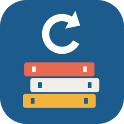

<p align="center">
  
</p>

<h1 align="center">Münchner Stadtbibliothek</h1>

<p align="center">
  Library card and loans of the Münchner Stadtbibliothek in Home Assistant, with renewal at the press of a button.
</p>

<p align="center">
  <a href="https://github.com/hacs/integration"></a>
  <a href="https://github.com/beatschubser/ha-muenchner-stadtbibliothek/releases"></a>
  <a href="https://github.com/beatschubser/ha-muenchner-stadtbibliothek/actions/workflows/validate.yml"></a>
</p>

> [!WARNING]
> **Work in progress.** Unofficial integration, not affiliated with the Münchner Stadtbibliothek. It reads the account pages of the online catalog; if the library changes these pages, the integration may stop working until it is updated.

> [!NOTE]
> The code is 100% AI-generated.

## Features

- **Card valid until** as a date sensor.
- **Loans** with due date, library, title, author, shelf mark, barcode and the catalog's hint (e.g. "verlängerbar", "Heute verlängert").
- **Next due date** with the titles due on that day.
- **One renew button per loan.** Buttons appear and disappear with the loans. Items that cannot be renewed are not sent to the catalog; pressing their button shows the reason instead.
- Several cards (e.g. one per family member), each with its own device.
- Low traffic: every update is one short catalog session (login, overview, loans, logout). Default interval 4 hours, adjustable from 1 to 48 hours.

## Installation

1. HACS → three dots → **Custom repositories** → add `https://github.com/beatschubser/ha-muenchner-stadtbibliothek`, type **Integration**.
2. Install **Münchner Stadtbibliothek** and restart Home Assistant.
3. **Settings → Devices & services → Add integration → Münchner Stadtbibliothek**.
4. Enter a name, card number and password (the same as for the online catalog).

The update interval can be changed later under **Configure**.

## Dashboard card

The integration brings its own card and registers it as dashboard resource automatically (reload the browser once after installing or updating).

**Edit dashboard → Add card → Münchner Stadtbibliothek.** All options can be set in the visual editor, the card size in the layout tab:

| Option | Default | |
| --- | --- | --- |
| `account` | all | name of one library card (the name given during setup, or the renamed device name). Without it, all cards are shown as selection pills |
| `title` | name of the library card | heading when only one library card is shown |
| `show_card` | `true` | "card valid until" in the header |
| `loan_days` | `28` | loan period in days, shown as a full ring |
| `appearance` | `auto` | `auto` (theme), `light`, `dark` |

```yaml
type: custom:muenchner-stadtbibliothek-card
account: Anna   # optional, the name given during setup
```

With several library cards set up (one per family member, each with its own name), the card shows a pill per name at the top; tap one to switch. To show only one person, choose the name in the editor.

Each loan shows the remaining days as a ring (orange from 3 days, red when overdue), title, author, library and due date. Renewable items get a "Renew" button, items renewed today a green "Renewed today"; items that cannot be renewed have no button. In narrow columns the buttons become icons.

## Entities

| Entity (English / German name) | State | Attributes |
| --- | --- | --- |
| Card valid until / Ausweis gültig bis | date | |
| Loans / Ausleihen | number of loans | `loans` (list), `renewable`, `last_update` |
| Next due date / Nächste Fälligkeit | date | `count`, `titles`, `renewable` |
| Renew *title* / *Titel* verlängern (button) | | `barcode`, `title`, `author`, `full_title`, `signature`, `library`, `due_date`, `hint`, `renewable`, `renewed_today`, `renewals` |

Each item in the `loans` attribute has the same fields as the button attributes.

## Examples

Renew everything that is due within three days (checks once a day):

```yaml
triggers:
  - trigger: time
    at: "08:00:00"
actions:
  - variables:
      due: >
        
        {{ expand(integration_entities('muenchner_stadtbibliothek') | select('match', 'button\\.') | list)
           | selectattr('attributes.renewable', 'eq', true)
           | selectattr('attributes.due_date', 'le', limit)
           | map(attribute='entity_id') | list }}
  - condition: template
    value_template: "{{ due | count > 0 }}"
  - action: button.press
    target:
      entity_id: "{{ due }}"
```

Loans as a list on a dashboard (Markdown card; replace the entity ID with yours):

```yaml
type: markdown
content: >
  
  **{{ loan.title }}** · {{ as_timestamp(loan.due_date) | timestamp_custom('%d.%m.') }} · {{ loan.hint }}
  
```

## How it works

The catalog runs aDIS/BMS. The integration logs in through the catalog's normal login form, opens the account overview and the loans page and logs out again. Renewing marks the item and presses "Markierte Medien verlängern", exactly like in the browser; the answer of the catalog is shown right away.

Card number and password are stored in the Home Assistant config entry and only sent to `ssl.muenchen.de`.
